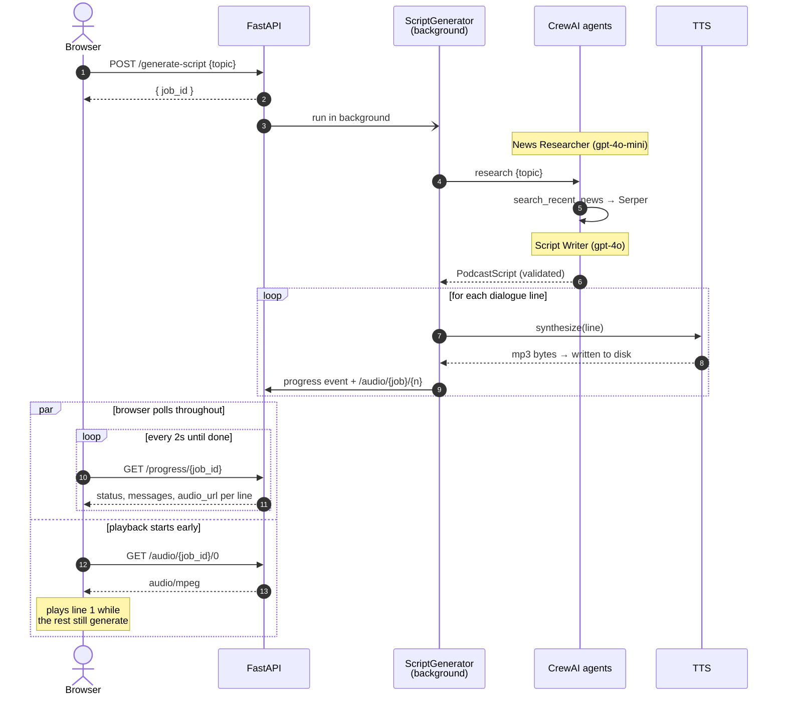
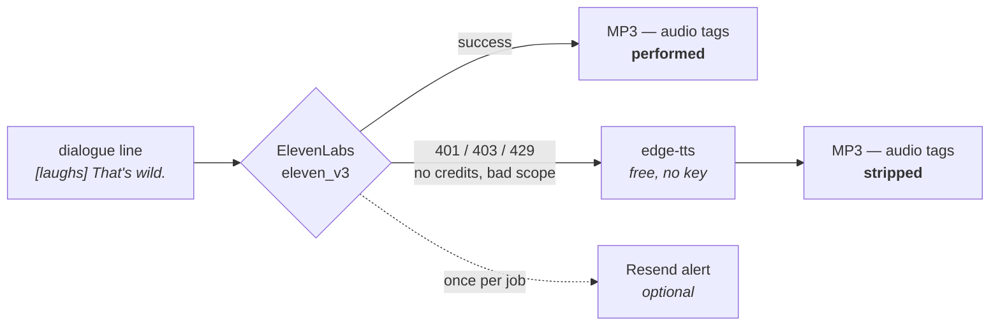

# Podcast Audio Generator

This web application generates a realistic interactive podcast conversation between an interviewer and an interviewee, using the latest news on a given topic.

Give it a topic. A CrewAI research agent searches recent news on it, a writer agent turns that into a two-person interview script, and each line is synthesized to speech and streamed back to the browser as it is generated.

## Demo Video
[Watch the Demo](https://youtu.be/tvtCSuJzYpc)

## Technology Stack

**Frontend:** React.js, Vite, Framer Motion, Tailwind CSS

**Backend:**
- **Python** and **FastAPI** for the API
- **CrewAI** for the two-agent research → writing pipeline
- **OpenAI** (`gpt-4o-mini` + `gpt-4o`) as the LLM, with a free **Groq** backend as an alternative
- **Serper** for news search
- **ElevenLabs** for expressive text-to-speech, with a free **edge-tts** fallback
- **Resend** (optional) to alert you when ElevenLabs credits run out

## Architecture

Generation is an **async job**: the request returns immediately with a `job_id`, the work happens in the background,
and the browser polls for progress. Because each line's MP3 lands as soon as it's synthesized, playback starts on
line 1 while the rest are still being written.



### The TTS fallback

ElevenLabs' free tier is only ~10k characters a month, so running out is the expected case, not the exceptional one.
Rather than fail the job, the provider **degrades to a free voice and finishes**:



The job runs in the background and reports progress into an in-memory store, which the frontend polls. Because each
line's MP3 is written the moment it's synthesized, the player can start on line 1 while the rest are still being
generated — it waits and resumes automatically if it catches up to the generator.

The dotted TTS edge is the important one: if ElevenLabs rejects us (no credits, missing permission, bad key), the
job **degrades to the free edge-tts voice and still finishes** rather than failing. That path is load-bearing, not
theoretical — the ElevenLabs free tier is only ~10k characters/month.

The frontend polls `/progress/{job_id}` and shows the player as soon as the **first** line's audio is ready, then keeps appending lines as they stream in. If playback catches up to the generator it waits for the next line and resumes automatically, so you start listening long before the podcast is finished.

### Emotion

Lines are performed using **ElevenLabs v3 audio tags** written inline in the text by the writer agent:

```json
{ "text": "[laughs] Everything, honestly... [pauses] let me start at the beginning.",
  "voice": "Female", "stability": 0.3 }
```

`stability` controls delivery (lower is more emotive, higher more measured). The free edge-tts fallback cannot perform tags, so it strips them.

## Running Locally

### Prerequisites

- **Python 3.10+** (3.12 recommended — CrewAI requires `>=3.10,<3.14`)
- **Node.js** 18+
- A **Groq** API key (free — https://console.groq.com/keys)
- A **Serper** API key (free tier — https://serper.dev)
- Optionally an **ElevenLabs** API key. Without one the app still runs and uses the free edge-tts voice.

### Backend

```bash
cd back_end
python3.12 -m venv .venv && source .venv/bin/activate
pip install -r requirements.txt

cp .env.example .env      # then fill in your keys
uvicorn main:app --reload
```

The API runs at `http://localhost:8000`. Check it with `curl localhost:8000/health`.

### Frontend

```bash
cd front_end
npm install
npm run dev
```

Runs at `http://localhost:3000`. It defaults to a backend at `http://localhost:8000`; override with
`VITE_API_BASE_URL` (see `front_end/.env.example`). Vite inlines that at **build** time, so a deploy must set it as
a build env var, not a runtime one.

`npm run build` produces `front_end/build/`; `npm test` runs the Vitest suite.

### Environment Variables

| Variable | Required | Description |
|---|---|---|
| `LLM_BACKEND` | no | `openai` (default when an OpenAI key is present) or `groq`. |
| `OPENAI_API_KEY` | **yes**\* | LLM for both agents. Paid, but ~a fraction of a cent per podcast. |
| `GROQ_API_KEY` | **yes**\* | Only if `LLM_BACKEND=groq`. Free, but heavily rate-limited. |
| `SERPER_API_KEY` | **yes** | News search. Free tier. |

\* One or the other, matching your `LLM_BACKEND`.
| `ELEVENLABS_API_KEY` | no | Expressive TTS. Omit to use the free edge-tts voice. |
| `ELEVENLABS_MODEL_ID` | no | Defaults to `eleven_v3` (the model that performs audio tags). |
| `ELEVENLABS_VOICE_MALE` / `ELEVENLABS_VOICE_FEMALE` | no | Voice IDs. List yours via `GET /v1/voices`. |
| `TTS_PROVIDER` | no | `elevenlabs` (default) or `edge-tts`. |
| `RESEARCH_MODEL` / `WRITER_MODEL` | no | Both default to `openai/gpt-oss-120b`. |
| `CORS_ORIGINS` | no | Comma-separated allowed origins. Defaults to `*`. |
| `RESEND_API_KEY`, `ALERT_EMAIL_TO` | no | Emails you when ElevenLabs credits run out. Logs instead if unset. |

### Tests

```bash
cd back_end
pip install -r requirements-dev.txt
pytest
```

## Free-Tier Constraints

This project is built to run entirely on free tiers, which imposes two real limits worth knowing before you deploy it:

- **The LLM is the one thing worth paying for.** Groq's free tier allows only **8,000 tokens per minute and 200,000 per day**, and an agent loop resends its whole conversation on every iteration — so tokens, not request count, are the binding constraint. In practice that means one job at a time, frequent 429s, and roughly 20–30 podcasts before the daily cap locks you out. OpenAI removes all of that for well under a cent per podcast on `gpt-4o-mini`, which is why it's the default. Groq remains available via `LLM_BACKEND=groq` if you want a zero-cost run.
- Because Groq's token ceiling is so tight, the research tool returns compact headlines and snippets rather than scraping full article bodies (which would blow the per-minute budget in a single turn). On the OpenAI backend it fetches more articles and longer snippets, since rate limits are no longer the constraint.
- **ElevenLabs free is ~10,000 characters/month** (roughly three podcasts) and grants no commercial-use rights. When credits run out the backend **automatically falls back to edge-tts** and finishes the job rather than failing it, optionally emailing you via Resend. For a demo that reliably showcases ElevenLabs quality, their $5/mo tier is the realistic floor.

## Notes and Limitations

- **Job state is in-memory.** It does not survive a restart and breaks with `uvicorn --workers > 1`. Fine for a single-instance demo; swap in Redis to scale out.
- **TTS is sequential**, so a 10-line podcast takes a little while. The frontend plays lines as they arrive, which hides most of this.

## Endpoints

| Method | Path | Description |
|---|---|---|
| `GET` | `/health` | Liveness check. |
| `POST` | `/generate-script` | `{"topic": "..."}` → `{"job_id": "..."}`. Work runs in the background. |
| `GET` | `/progress/{job_id}` | Job status, progress events, and the final script. `404` if unknown. |
| `GET` | `/audio/{job_id}/{line_number}` | The MP3 for one dialogue line. |

## License
[MIT](LICENSE)
